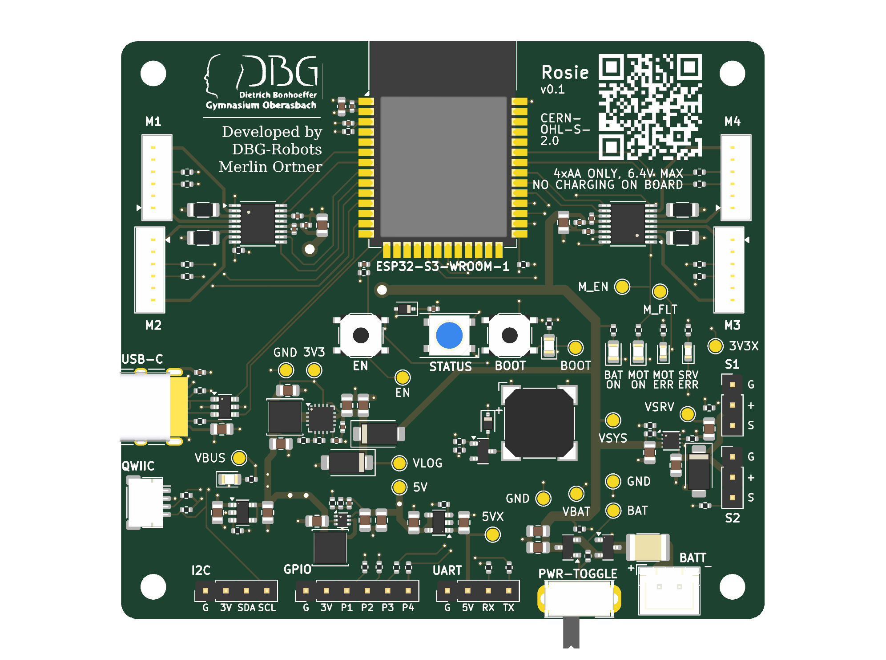

# Rosie

A small robot controller board for learning ROS and micro-ROS. It was designed by the DBG-Robots team at the Dietrich-Bonhoeffer-Gymnasium Oberasbach for students between 14 and 18.

**Status: v0.1, not built or tested yet.** The design passes KiCad's ERC and DRC and was checked against the datasheets, but no board has been powered up. The first batch is ordered from JLCPCB, and this README will get a "what we got wrong" section once the boards arrive. Treat everything below as the plan, not as proven.

## What it is for

We teach robotics to students who mostly have never touched a microcontroller, let alone ROS. The usual options are either a Raspberry Pi with a pile of loose modules and jumper wires, or a finished kit where you can't see how anything works.

Rosie sits in between. One board holds everything a small wheeled robot needs: the ESP32-S3, four motor outputs with encoder inputs, servo outputs, power handling, and a few connectors for sensors. The ESP32 talks to a computer running ROS 2 through micro-ROS, so students write robot code the way professionals do and never solder a motor driver.

Two decisions shaped the whole board:

1. **Nothing to wire for the standard case.** The motor connectors match the motor we use, so a student plugs in a cable and drives.
2. **Mistakes should be survivable.** A reversed battery, a stalled motor or a shorted servo cable should trip a protection instead of destroying the board, because the board will be handled by teenagers in a classroom.

## Features

- **ESP32-S3-WROOM-1-N8R2** module (8 MB flash, 2 MB PSRAM), USB-C for flashing, serial and power.
- **Four DC motor outputs** from two DRV8833 dual H-bridges. Each output has an encoder input (quadrature, ESP32 pulse counters).
- **Two servo headers** with their own current-limited supply.
- **Lidar/UART header** with 5 V, **Qwiic/I2C** socket plus an extra I2C pin header, and a **6-pin GPIO header** (J12, four free ESP32 pins named P1 to P4).
- **RGB LED** (WS2812-compatible) and a **buzzer** for status and "hello world" feedback.
- **Battery voltage measurement** so firmware can warn before the cells run flat.
- **EN and BOOT buttons**, and a **power switch**.
- **Debug LEDs and test pads** so students (and we) can see which rail or fault is the problem without a multimeter in hand.
- **Mounting holes on LEGO's 8 mm grid** (72 × 64 mm apart), so the board can be bolted to Technic frames.

## Power

Rosie runs from **four AA cells in a flat holder** fixed under the board (NiMH 1900 to 2500 mAh gives roughly three hours, alkaline cells also work). That is 4.0 to 6.4 V.

> **Rosie does not charge batteries.** There is no charger on the board. Charge NiMH cells in an external AA charger and only then put them in the holder. Do not connect anything other than 4 AA cells (max 6.4 V) to the battery connector. Do not put lithium cells there.

Why AA cells and not a LiPo: they are cheap, they can be bought in any shop, students swap them in seconds, and a classroom full of lithium cells and 14-year-olds is a risk we did not want. The price is that the voltage sags and that the board needs a good 3.3 V converter.

### Rails

| Rail | Comes from | Feeds |
|---|---|---|
| +BATT | AA holder, through a resettable fuse and a reverse-polarity P-FET | power switch |
| VSYS | after the power switch, 4.0 to 6.4 V | motors, servo supply, logic supply |
| VBUS | USB-C | logic supply only |
| VLOGIC | the higher of VSYS and VBUS (two Schottky diodes) | the 3.3 V converter |
| +3V3 | TPS62130A buck converter, 3.31 V | ESP32, pull-ups, buzzer, 5 V converter |
| +5V | TPS61023 boost converter from 3.3 V, 5.06 V | RGB LED, lidar header |
| VSERVO | TPS259571 eFuse, 2 A limit | servo headers |
| +3V3_EXT | SY6280 switch, 0.57 A limit | encoders, I2C, GPIO header |
| +5V_EXT | SY6280 switch, 0.68 A limit | lidar header |

The important consequences:

- **USB powers only the logic.** You can plug in USB to flash and debug without the motors or servos moving. Motors need the battery and the power switch.
- **USB never feeds the battery rails.** The two diodes stop current going the other way.
- **The 3.3 V converter runs from 3 to 17 V and can stay at 100 % duty**, so the ESP32 keeps running while the cells droop towards 4 V. A linear regulator would have lost the 3.3 V earlier and wasted battery as heat.
- **Servos get their own protected rail.** A shorted servo cable current-limits and shuts down that rail only. The ESP32 keeps running and the red SRV ERR LED turns on if it overheats.
- **Encoders and sensors are supplied by switches with a current limit** (SY6280), so a shorted sensor cable does not take the 3.3 V rail down with it.

## Connectors

All pinouts are listed from pin 1.

| Ref | Connector | Pins |
|---|---|---|
| J1 | USB-C | power, flashing, serial console |
| J2 | JST XH, 2-pin | battery: pin 1 = +, pin 2 = GND |
| J3 to J6 | JST ZH 1.5 mm, 6-pin | motors M1 to M4: 1 motor-, 2 GND, 3 encoder A, 4 encoder B, 5 +3.3 V, 6 motor+ |
| J7 | JST SH, 4-pin | Qwiic: GND, 3.3 V, SDA, SCL |
| J8 | 2.54 mm header, 4-pin | I2C: GND, 3.3 V, SDA, SCL |
| J9, J10 | 2.54 mm header, 3-pin | servo 1 and 2: GND, servo supply, signal |
| J11 | 2.54 mm header, 4-pin | lidar UART: GND, 5 V, RX, TX |
| J12 | 2.54 mm header, 6-pin | GND, 3.3 V, P1, P2, P3, P4 |

The motors are numbered counter-clockwise looking from above: M1 front-left, M2 rear-left, M3 rear-right, M4 front-right.

The motor connector order is that of the **CHIHAI CHF-GM12-N20** gear motor with its 6-pin ZH cable (6 V, hall encoder). Other N20 motors use other pin orders, and a wrong order can swap encoder power and ground. Plug a new motor type in with the board unpowered and check with a multimeter first.

Every encoder, servo, UART and GPIO signal passes through a 1 kΩ series resistor. A wrong connection then pushes only a milliamp or two into the ESP32 pin instead of burning it.

## Debug LEDs and test pads

| LED | Silk | Lights when |
|---|---|---|
| green | 3V3 | the 3.3 V rail is up |
| green | USB | USB power is present |
| green | BAT ON | the power switch is on and the battery is connected |
| yellow | MOT ON | firmware has enabled the motor drivers |
| red | MOT ERR | a DRV8833 reports overcurrent, overheating or undervoltage |
| red | SRV ERR | the servo eFuse shut down because of overheating |

If a rail is in doubt, the 1.5 mm round **test pads** on the top side give direct access to BAT, VSYS, VBUS, VLOG, 3V3, 5V, 3V3X, 5VX, VSRV, EN, BOOT, MOT_EN, MOT_FLT, VBAT and three ground points. Hold a multimeter probe on the pad and a second one on GND.

The four expansion pins on J12 are labelled P1 to P4 on the board on purpose. We did not want ESP32 GPIO numbers printed on the silk, because students would start thinking in pin numbers instead of functions. A student guide will map P1 to P4 to GPIOs.

## GPIO map

| GPIO | Function |
|---|---|
| IO6, IO7 | M1 PWM inputs |
| IO16, IO15 | M2 PWM inputs |
| IO37, IO38 | M3 PWM inputs |
| IO40, IO39 | M4 PWM inputs |
| IO5, IO4 | encoder 1 A, B |
| IO17, IO18 | encoder 2 A, B |
| IO36, IO35 | encoder 3 A, B |
| IO41, IO42 | encoder 4 A, B |
| IO10 | motor driver enable (internal pull-down, so motors stay off while the ESP32 boots) |
| IO21 | motor driver fault input (both drivers wired together) |
| IO8, IO9 | I2C SDA, SCL |
| IO11, IO12 | servo 1 and 2 PWM |
| IO43, IO44 | UART0 TX, RX (lidar header) |
| IO47 | buzzer |
| IO48 | RGB LED data |
| IO1, IO2, IO13, IO14 | J12 pins P1 to P4 (P1 and P2 can read analog) |
| IO3 | battery voltage (divider 1:3, so 6.4 V reads as 2.13 V) |
| IO0, IO19, IO20 | BOOT, USB D-, USB D+ |
| IO45, IO46 | strapping pins, not connected |

The firmware should **ramp the motors up** instead of jumping to full power. Four stalled N20 motors can briefly pull more than the AA cells can give, and the resulting voltage dip can reset the ESP32. Warn at 4.4 V battery voltage and stop the motors at 4.0 V.

## Design decisions

### Parts and cost

The board is built for **JLCPCB Economic assembly**, which means single-sided SMD assembly, and a limited parts catalogue. Every part was checked for stock and Economic eligibility. JLC charges $3.07 for each *unique* "Extended" part per order and nothing extra for "Basic" parts, so we:

- chose Basic parts wherever one exists (all the resistors except the 0.2 Ω shunts, all capacitors, diodes, MOSFETs, LEDs, buttons),
- recalculated the voltage dividers to values that exist as Basic resistors (3.3 V: 47 k / 15 k, 5 V: 15 k / 2 k),
- accepted 14 Extended parts, because there is no Basic alternative for the ICs, USB-C connector, ZH connector, inductor, fuse, buzzer and RGB LED.

The first order of five assembled boards came to roughly $112 before shipping and VAT, which is about $22 per board. More boards per order is the cheapest way to lower that, since the Extended-part fee is fixed.

The ESP32 module, the pin headers, the XH battery connector and the slide switch are **hand-soldered**. The JST ZH motor connectors are through-hole too, but JLC solders them. The full list with LCSC numbers is in [PARTS.md](PARTS.md), including the checks against the datasheets.

### Board and layout

- 80 × 72 mm, **four layers**: top = parts and power, inner 1 = unbroken ground, inner 2 = 3.3 V plane with a few thin power traces, bottom = signals. We chose four layers because the DRV8833s and the buck converter need a quiet ground, and because the cost difference at this size is small.
- All SMD parts are on the top side, because Economic assembly does single-sided only.
- The bottom side is flat enough that a 4×AA holder can be taped or screwed under the board. No through-hole parts sit in the 62 × 58 mm area in the middle of the bottom. Where the holder goes is up to the student; the board has no holder holes.
- The four M3 mounting holes are 72 × 64 mm apart, which is 9 × 8 studs on LEGO's 8 mm grid. Bolt them to Technic beams or use standoffs. The solder tails and the AA holder need 5 to 8 mm of room below.
- Signals were routed by hand by the team. The autorouter was tried and dropped.

### Motor drivers

The DRV8833 is a cheap, well-known dual H-bridge, with a current limit set by resistors. We use the two-pin PWM mode, and all four outputs share one enable and one fault line. Four motors on two chips keep the part count low.

### Protection

- A P-FET (not a diode) handles reverse battery polarity, so there is almost no voltage drop.
- A 3 A resettable fuse sits after the battery connector. Be aware that this kind of fuse trips at lower current when warm (about 2.3 A at 50 °C), so a warm robot can trip it at stall currents a cold one handles.
- USB data lines have an ESD protection chip.
- Servo and sensor rails have current limiting as described above.

### Silkscreen

JLCPCB wants silkscreen text at least 1.0 mm tall with a 0.15 mm stroke, so all labels are at that size or larger. The slide switch has no ON/OFF labels yet, because we have not verified which direction is ON on the real part.

The QR code at the top right links to our GitHub organization. It is drawn as silkscreen so that the code area is mask-coloured on a white silk background, which scans like a printed code.

## Files

| Path | What |
|---|---|
| `Rosie.kicad_pro`, `.kicad_sch`, `.kicad_pcb` | KiCad 10 project. Sheets: MCU, power input, power conversion, motor drivers, I/O peripherals, USB, debug |
| `libs/` | project symbols, footprints and 3D models for the parts that KiCad's own libraries do not have |
| `libs/3d-generator/` | script that generates the simplified 3D models (needs FreeCAD) |
| `production/` | Gerbers (`Rosie.zip`), JLC BOM and position files |
| `PARTS.md` | part numbers, datasheet checks, rail and GPIO tables |
| `docs/` | pictures |

Open `Rosie.kicad_pro` in KiCad 10. The library tables use relative paths, so it should work wherever you clone it.

## Known open points

- The ON direction of the slide switch SW3 is unverified (hence no labels).
- No hardware test yet. First checks when boards arrive: all red LEDs dark with only USB connected, 3.3 V and 5 V rails measured, 5 V rail noise after the divider change, LED brightness.
- 3D models are simplified and drawn from datasheet outlines, not from the manufacturers' CAD.
- Silkscreen: four footprint outlines (USB-C and the ESP32 footprint) reach past the board edge. This is harmless.

## Licence

Hardware design files (schematics, PCB, footprints, models, production files): **CERN-OHL-S-2.0**, see [LICENSE-hardware.txt](LICENSE-hardware.txt). In short: you may build, modify and sell it, but if you share a modified design, it has to stay open under the same licence. Firmware and software live in separate repositories with their own licences.

## Credits

Designed by Merlin Ortner with the DBG-Robots team, Dietrich-Bonhoeffer-Gymnasium Oberasbach.
